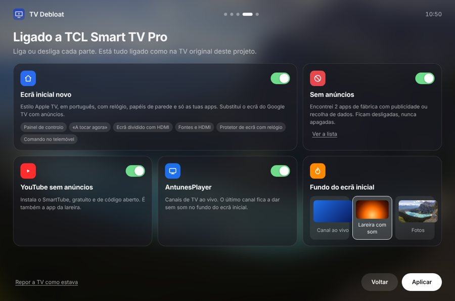

Computer Engineering student in Portugal. I build Android apps, smart-TV tools and websites for local businesses, and I care about how they look as much as how they work.

<h3>Languages</h3>

 

<h3>Platforms and tools</h3>

  

<h2 align="center">Featured</h2>

<table>
<tr>
<td width="34%" align="center" valign="middle"></td>
<td width="66%" valign="top">

### AntunesPlayer
An **IPTV player** for Android phones, **Google TV** and the web, with **AntunesFlix** inside: films and series organised like a streaming service, a TV guide, catch-up, favourites in your order and Google sign-in to sync everything. Bring your own Xtream login or M3U list.

`JavaScript` `hls.js` `Capacitor` `Firebase` `Android TV`

</td>
</tr>
</table>

   

<table>
<tr>
<td width="66%" valign="top">

### TV Debloat · design UNIQUE
Turns an ad-filled **TCL Google TV** into a clean **Apple TV-style** home screen: reversible removal of ad and telemetry apps, a dock of favourite apps, a control panel, the live channel playing muted behind the menu or a **fireplace with sound**, and **split screen** with an HDMI input.

**TVDebloat.exe** does it all for people who don't code: it finds the TV on the network, lets you pick the features and undoes everything with one button. **Comando TV** is the matching Android phone remote over Wi‑Fi.

`Java` `C#` `Android TV` `ADB` `PowerShell`

</td>
<td width="34%" align="center" valign="middle"></td>
</tr>
</table>

<h2 align="center">Apps</h2>

<table>
<tr>
<td width="33%" valign="top" align="center">
 

**[Ledgerly](https://github.com/JoaoAntunesss/ledgerly)** 
Money manager for home and small business: bills, subscriptions, loans, invoices and VAT. Private, with encrypted sync.  

</td>
<td width="33%" valign="top" align="center">
 

**[ReelPick](https://github.com/JoaoAntunesss/reelpick)** 
A slot machine for films and series. Pick genres, your streaming services and a mood, pull the lever.  

</td>
<td width="33%" valign="top" align="center">
  

**[Cockpit](https://github.com/JoaoAntunesss/cockpit)** 
Car logbook for Android: real fuel consumption, maintenance and deadline reminders, cost per km, fuel prices and EV chargers nearby, widgets. Colours follow the car's brand.  

</td>
</tr>
</table>

<h2 align="center">Websites for local businesses</h2>

<table>
<tr>
<td width="50%" valign="top">

**[Template Studio](https://github.com/JoaoAntunesss/template-studio)** 
Booking website for beauty salons: next free slot in real time, booking in three steps, a management panel and WhatsApp notices. Already running for a real salon.

</td>
<td width="50%" valign="top">

**[Template Restaurant](https://github.com/JoaoAntunesss/Template-Restaurant)** 
Restaurant site with a digital menu shaped like a book, opened from the table's QR code. The owner edits dishes and prices in a panel.
<a href="https://joaoantunesss.github.io/Template-Restaurant/public/menu.html">Try the menu</a>

</td>
</tr>
</table>

<h2 align="center">Tools and AI agents</h2>

<table>
<tr>
<td width="50%" valign="top">

**[Bets Agents](https://github.com/JoaoAntunesss/Bets-Agents)** 
A team of 18 AI agents on Claude Code that studies the day's football: collectors, market experts, a jury with veto and a president who signs off. It tracks profit and ROI over time and never places bets.

</td>
<td width="50%" valign="top">

**[FB Pulse](https://github.com/JoaoAntunesss/fb-pulse)** 
A free dashboard for Firebase projects: are the servers up, active and registered users, and the errors apps reported in the last 24 hours. Runs on GitHub Actions.
<a href="https://joaoantunesss.github.io/fb-pulse/">Open the dashboard</a>

  

**[TV Debloat (desktop)](https://github.com/JoaoAntunesss/tv-debloat)** 
The first version of the TV cleaner: a Python and Tkinter app over wireless ADB, step by step and reversible.

</td>
</tr>
</table>

<table>
<tr>
<td width="33%" valign="top">

**Education** 
Computer Engineering (Engenharia Informática), student

</td>
<td width="33%" valign="top">

**Experience** 
Administrative work Câmara Municipal de Matosinhos

</td>
<td width="33%" valign="top">

**Spoken languages** 
Portuguese, native English, fluent

</td>
</tr>
</table>

  
  

<i>"First make it work, then make it beautiful."</i>

