


 

  

## 📺 Featured project

<table>
<tr>
<td width="62%">

### AntunesPlayer
An **IPTV player** for Android phones, **Google TV** and the web, with **AntunesFlix** inside: films and series organised like a streaming service. Bring your own Xtream login or M3U list (no channels included).

`JavaScript` `hls.js` `Capacitor` `Firebase` `OpenSubtitles API` `Android TV` `GitHub Actions`

</td>
<td width="38%" align="center">

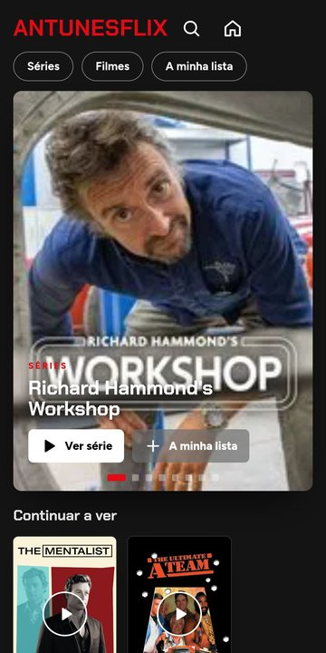

</td>
</tr>
</table>

<table>
<tr>
<td width="50%" valign="top">

**🍿 AntunesFlix** 
Billboard, Top 10, a row per genre, My list 
Continue watching across films and series 
Next-episode countdown in the last seconds 
Watched marks, resume T1:E3, “more like this” 
Its own intro animation

</td>
<td width="50%" valign="top">

**📡 Live TV** 
TV guide grid, catch-up, reminders 
Number zapping and favourites in your order 
See-through channel list on the remote's ◀ 
Sleep timer, stream info and quality picker 
Open in VLC / MX Player

</td>
</tr>
<tr>
<td width="50%" valign="top">

**☁️ Your account** 
Sign in with Google: playlists (logins encrypted), favourites, progress and settings on every device 
A TV signs in with a short code from the phone

</td>
<td width="50%" valign="top">

**🎨 Yours to shape** 
Pick the app colour, the AntunesFlix colour and the background 
Online subtitles in your languages, switched on by themselves 
In-app updates · Portuguese and English · parental PIN

</td>
</tr>
</table>

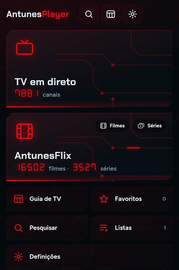 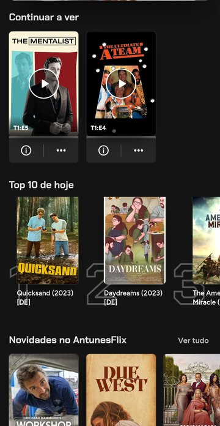 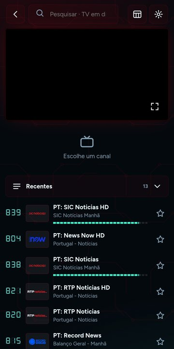 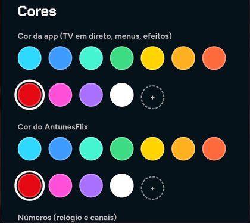

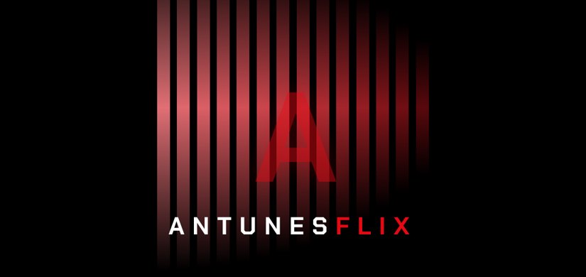

## 🚗 Also featured

<table>
<tr>
<td width="62%">

### Cockpit
A car logbook for **Android**. Fuel consumption, maintenance, expenses, deadlines (insurance, inspection, road tax), fuel prices, parking spots and widgets. The app's colours follow the car's brand.

`Kotlin` `Jetpack Compose` `Room` `WorkManager` `Firebase`

</td>
<td width="38%" align="center">

**Highlights**

⛽ Real consumption per refuel 
🔧 Maintenance and deadline reminders 
💶 Cost per km and month forecast 
📍 Nearby parking and fuel stations 
🔄 In-app updates

</td>
</tr>
</table>

<table>
<tr>
<td width="62%">

### Ledgerly
A money manager for **home and small business** that runs in the browser and installs on your phone. Bills with *why they went up*, subscriptions, loans, income, spending by month with a savings planner, invoices and VAT. Everything stays on your device, with optional end-to-end encrypted sync (Google sign-in or a family code) and 25 colour themes.

`JavaScript` `PWA` `three.js` `Firebase` `Web Crypto`

</td>
<td width="38%" align="center">

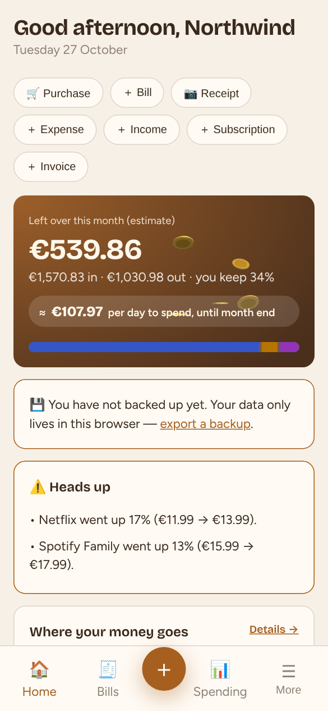

</td>
</tr>
</table>

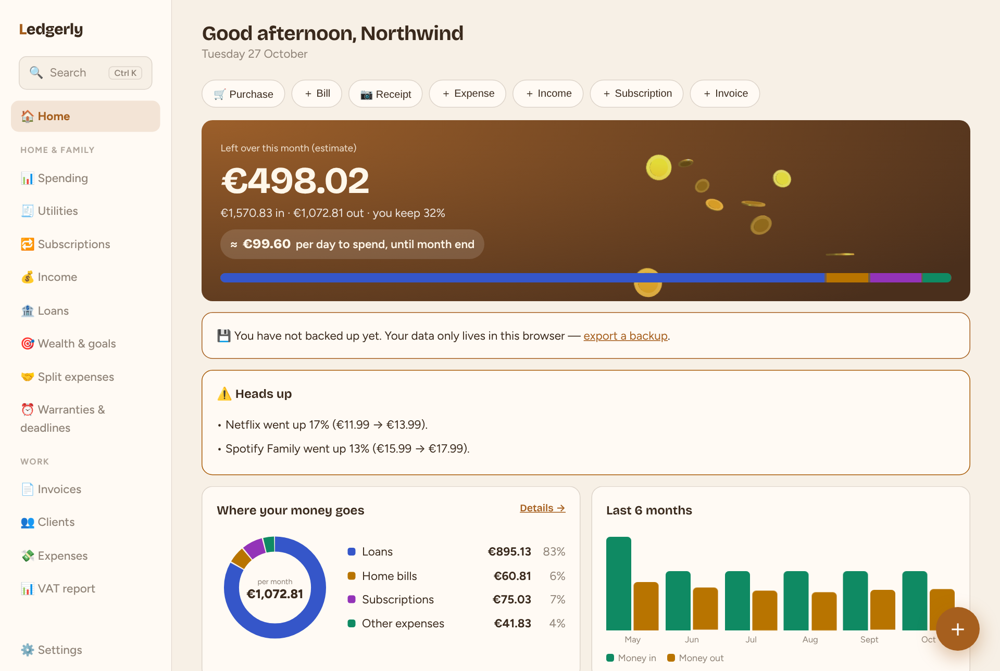

<table>
<tr>
<td width="62%">

### ReelPick
A **slot machine for movies and series**. Pick the type, genres, the streaming platforms you actually have and a mood, pull the lever, and the reel stops on a random title that matches. Optional Google sign-in for a seen list, friends, reviews and a daily pick.

`JavaScript` `three.js` `TMDB API` `Firebase`

</td>
<td width="38%" align="center">

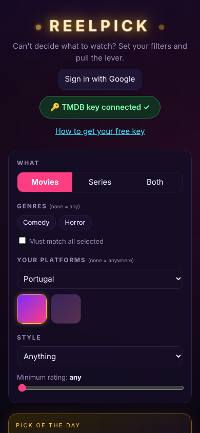

</td>
</tr>
</table>

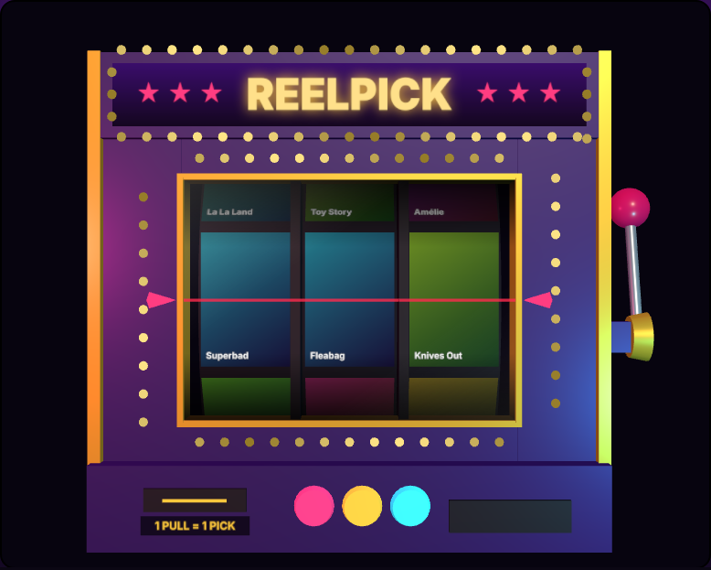

## 🤖 AI agents

### Bets Agents
A team of **18 AI agents on Claude Code** that studies the day's football matches. Collectors (form, referee, weather, injuries, news), market experts, a builder, a four-member jury that can veto, and a president who signs off. A local dashboard shows every agent at work, and a ledger tracks profit, ROI and hit rate over time. It never places bets and never promises profit.

`Claude Code` `Multi-agent` `Python` `Dashboard`

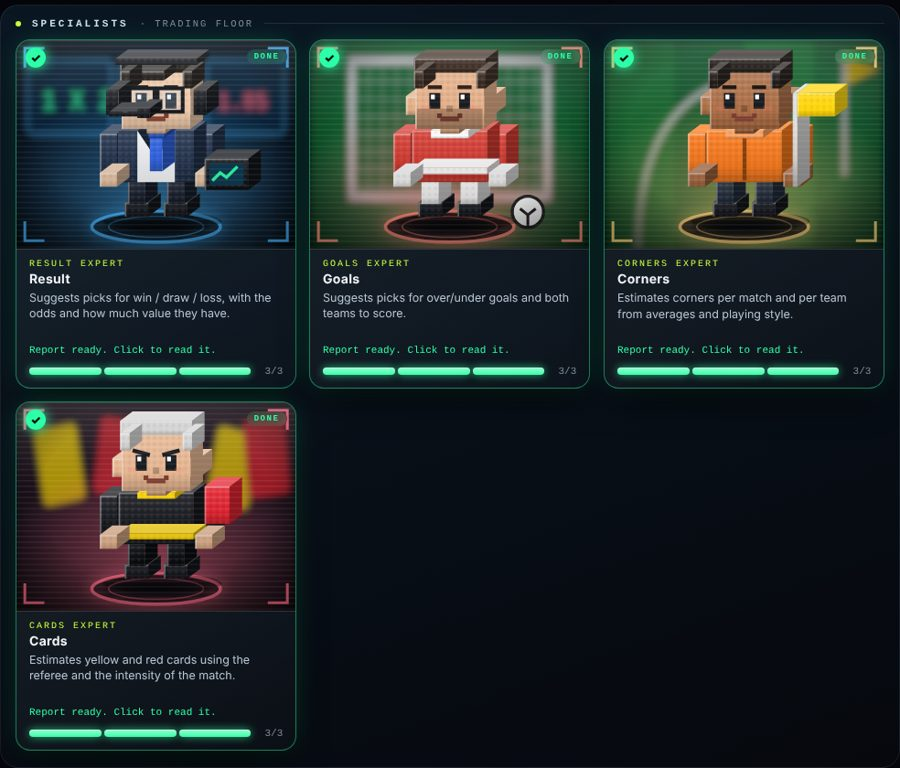

## 🎓 Education & experience

<table>
<tr>
<td width="50%" valign="top">

**🎓 Education** 
Computer Engineering (*Engenharia Informática*), student

**🌍 Languages** 
Portuguese · native 
English · fluent

</td>
<td width="50%" valign="top">

**🏛️ Experience** 
Administrative work · Câmara Municipal de Matosinhos

</td>
</tr>
</table>

## ✨ Beyond code

  
  
  
  

I combine technical skills with real-world experience in team management and public-sector administration, so I build software that solves practical problems for the people who use it.

## 🛠️ Tools

  
  
  
  
  
  
  
  
  

## 📊 Activity

  
  

  

<i>"First make it work, then make it beautiful."</i>

